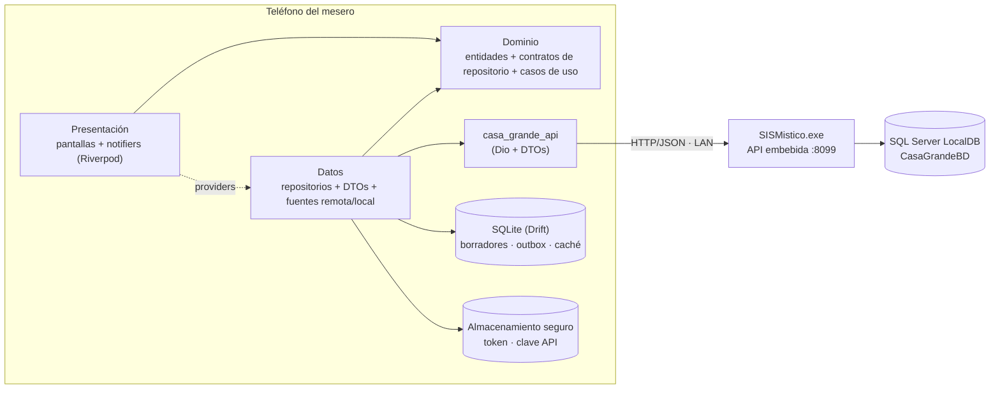
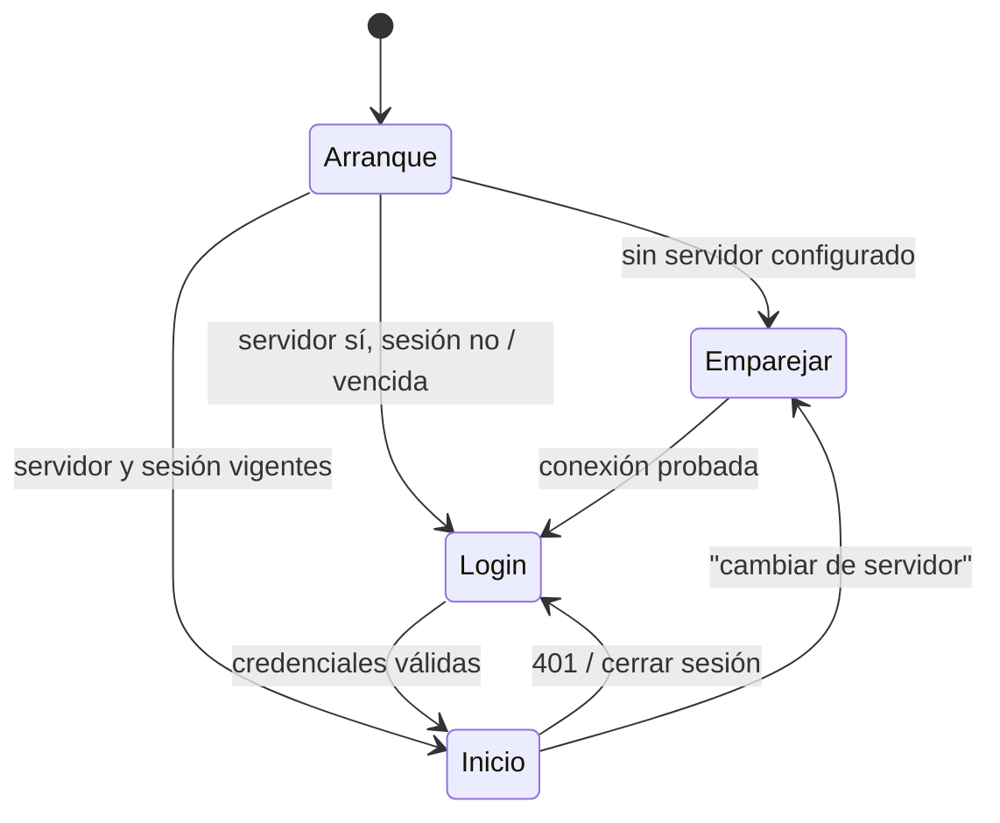
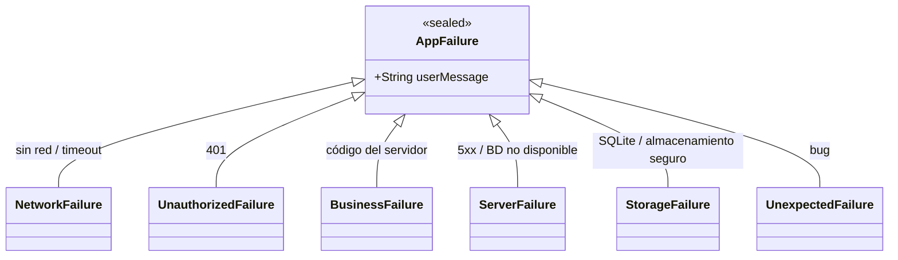
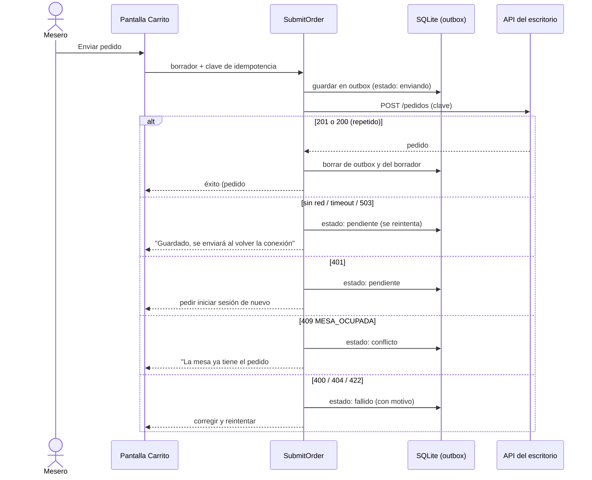

# 02 — Arquitectura

## 1. Vista general

El teléfono **nunca** habla con la base de datos: todo pasa por la API del escritorio. El teléfono guarda tres cosas
propias: lo que el mesero está armando (borradores), lo que ya pidió enviar y aún no se confirmó (*outbox*) y una copia del
menú (caché).

## 2. Capas y regla de dependencia

| Capa | Contiene | Puede importar | No puede importar |
|---|---|---|---|
| **Presentación** | Pantallas, widgets, *notifiers* de Riverpod, modelos de vista | Dominio, `core` | Datos, DTOs, Dio, Drift |
| **Dominio** | Entidades inmutables, enums, contratos (`abstract interface class`) de repositorios, casos de uso, fallos | Solo Dart y `core` puro | Flutter, Dio, Drift, DTOs |
| **Datos** | Implementaciones de repositorio, mapeadores DTO↔entidad, fuentes remota/local | Dominio, `casa_grande_api`, Drift | Presentación |

`presentation → domain ← data`: el dominio no conoce a nadie, de modo que se prueba sin Flutter y sin red. Los
repositorios se inyectan por Riverpod, así que en las pruebas se sustituyen por falsos.

**Casos de uso solo cuando hay lógica de verdad** (p. ej. `SubmitOrder`, `SyncOutbox`, `BuildOrderPayload`). Un caso de
uso que solo reenvía a un repositorio es ceremonia: los notifiers llaman al repositorio directamente.

## 3. Estado e inyección de dependencias: Riverpod 3

* Un solo mecanismo para estado y DI. Proveedores generados con `@riverpod` (generador) para evitar errores de
  tipo y obtener `family` y `autoDispose` por defecto.
* Reglas:
  * Los **repositorios** son proveedores de larga vida (`keepAlive`).
  * El estado de **pantalla** es `AsyncNotifier`/`Notifier` con `autoDispose`.
  * Se lee con `ref.watch` en `build` y con `ref.read` solo en callbacks.
  * Acciones del usuario (enviar, iniciar sesión) = método del notifier que usa `AsyncValue.guard`; la UI pinta
    `loading/error/data` con `when`/`switch` sobre el sealed `AsyncValue`.
  * Nada de `StateProvider`/`ChangeNotifierProvider` (pasaron a `legacy` en Riverpod 3).
* **No se usan las APIs experimentales** de Riverpod 3 (persistencia *offline* y *mutations*): la persistencia es
  nuestra (Drift) porque necesita consultas, índices y transacciones, y lo experimental puede romperse sin cambio de versión mayor.
* Pruebas: `ProviderContainer.test()` con `overrides` de los repositorios.

Proveedores principales:

| Proveedor | Tipo | Responsabilidad |
|---|---|---|
| `serverConfigProvider` | `AsyncNotifier<ServerConfig?>` | Host, puerto y clave de la API; vacío = pantalla de emparejamiento |
| `sessionProvider` | `AsyncNotifier<Session?>` | Empleado y token; login/logout; vence en `expiresAt` |
| `apiClientProvider` | `Provider<CasaGrandeApi>` | Cliente HTTP ya configurado con config + sesión |
| `catalogRepositoryProvider` | `Provider` | Menú: caché primero, red después |
| `tablesProvider` | `AsyncNotifier<List<DiningTable>>` | Mapa; sondeo periódico solo con la pantalla visible |
| `draftProvider(tableId)` | `Notifier<Draft>` | Borrador por mesa, persistido en cada cambio |
| `outboxProvider` | `StreamProvider<List<OutboxEntry>>` | Pedidos pendientes (consulta reactiva de Drift) |
| `orderSubmitterProvider` | `Provider` | Caso de uso `SubmitOrder` + sincronización de la bandeja |
| `connectivityProvider` | `StreamProvider` | Conectividad del sistema + `ping` al servidor |

## 4. Navegación: go_router

* Rutas declarativas con nombre y una **guarda global** (`redirect`) basada en el estado de la aplicación:

* `StatefulShellRoute.indexedStack` para la barra inferior (Mesas · Pendientes · Ajustes): cada pestaña conserva su pila.
* Un `401` en cualquier llamada emite un evento de sesión vencida; el *router* redirige a Login **conservando la ruta
  de origen** y los borradores intactos (están en SQLite).
* Rutas de ejemplo: `/setup`, `/login`, `/tables`, `/tables/:tableId/menu`, `/tables/:tableId/cart`,
  `/orders/:orderId`, `/outbox`, `/settings`.

## 5. Red: `casa_grande_api` (Dio)

Paquete de Dart puro con el contrato de la API tipado. La app no usa `Dio` directamente.

| Pieza | Función |
|---|---|
| `CasaGrandeApi` | Un método por endpoint, devuelve DTOs (`freezed` + `json_serializable`) |
| `ApiKeyInterceptor` | Añade `X-Api-Key` a todo salvo `/ping` |
| `AuthInterceptor` | Añade `Authorization: Bearer`; ante `401` notifica "sesión vencida" |
| `ErrorMapperInterceptor` | Traduce `DioException` y el sobre `{error:{codigo,mensaje}}` a `ApiException` tipada |
| `LoggingInterceptor` | Método, ruta, estado y duración. **Nunca** cuerpos ni cabeceras |
| Tiempos | Conexión 3 s, envío/recepción 10 s; `ping` 3 s. El `POST /pedidos` se **reintenta** (es idempotente); los `GET` también |
| Reintentos | Hasta 3 con espera creciente y *jitter*, **solo** ante errores de red/timeout/503; nunca ante 4xx |
| URL base | `http://<host>:<puerto>/api/v1`, validada: solo IP privadas (RFC 1918), `localhost` o `*.local` |

`ApiException` distingue: **sin conexión/tiempo agotado**, **401**, **error de negocio** (con `codigo`:
`MESA_OCUPADA`, `CLAVE_INVALIDA`, `DEMASIADOS_INTENTOS`, `VALIDACION`, `REGLA_NEGOCIO`, `CONFLICTO`, `NO_ENCONTRADO`,
`BD_NO_DISPONIBLE`) y **error del servidor** (5xx).

## 6. Errores: un solo vocabulario

* La capa de datos **lanza** `AppFailure` (jerarquía `sealed`); la presentación los captura con `AsyncValue.guard` y los
  muestra. No se usa `Either`/`Result` de terceros: con Dart 3 un `sealed` + `switch` exhaustivo basta y encaja con `AsyncValue`.

* Cada fallo trae un **mensaje para el usuario en español** (clave ARB), no el texto del servidor tal cual, salvo el
  `mensaje` de `BusinessFailure`, que ya está redactado para personas (p. ej. "La mesa 5 ya tiene un pedido pendiente (#123)").
* Errores no capturados: `FlutterError.onError`, `PlatformDispatcher.instance.onError` y una zona; todo va al registro
  local (Talker). Sin servicios externos.

## 7. Persistencia local y *offline*

| Dato | Dónde | Por qué |
|---|---|---|
| Token, clave de la API | `flutter_secure_storage` (Keystore/Keychain) | Secretos |
| Servidor (host, puerto), preferencias (tema) | `shared_preferences` | No son secretos |
| Borradores, bandeja de salida, caché de menú | **Drift** (SQLite) | Consultas reactivas, transacciones, migraciones |

### 7.1 Menú: caché primero (*stale-while-revalidate*)

1. Al abrir el menú se pinta lo guardado en SQLite (si existe) y se marca como "actualizando".
2. En segundo plano se pide a la API; si cambió, se reemplaza en una transacción y la UI se actualiza sola (el stream de Drift emite).
3. Sin red: se queda lo guardado y se muestra "Menú de hace X min". Vigencia sugerida: refrescar al abrir la app, al tirar
   para actualizar y cada 30 min. (Mejora posterior: `ETag` en la API para no descargar de nuevo si no cambió.)

### 7.2 Pedidos: borrador → *outbox* → servidor

Puntos finos:

* **La clave de idempotencia se crea al abrir el borrador**, no al pulsar enviar. Un reintento (incluso tras cerrar la
  app o reiniciar el teléfono) usa la misma clave, de modo que si el servidor sí creó el pedido y la respuesta se perdió,
  el reintento devuelve el mismo pedido (`200`) en vez de duplicarlo.
* Si el `.exe` del escritorio se reinició entre medio, la clave se olvidó en el servidor: el reintento recibe `409
  MESA_OCUPADA` con el número del pedido creado. La app lo reconoce (mensaje con `#id`) y lo trata como "ya estaba creado"
  si el pedido pertenece a su propio envío (ver [04 §4](04-modelo-de-dominio-y-datos.md)).
* La bandeja se sincroniza **en orden** (más antiguo primero), con un único trabajador a la vez; se dispara al volver la
  conexión, al abrir la app, al iniciar sesión y con el botón "Reintentar".
* Un pedido en conflicto o fallido **no se borra solo**: el mesero decide (ver, editar, descartar).

## 8. Sondeo del mapa de mesas

La API no tiene *push*. El mapa se actualiza por sondeo (`GET /mesas`) cada 10–15 s **solo** si la pantalla es visible y la
app está en primer plano (observador del ciclo de vida); se cancela al salir. Con ~19 meseros la carga es trivial (≈ 1–2
peticiones/s en el peor caso). Si en el futuro hace falta inmediatez, la API puede ofrecer SSE; no es necesario para el MVP.

## 9. Seguridad (resumen; detalle en [07](07-calidad-seguridad-y-pruebas.md))

* HTTP sin TLS dentro de la LAN (decisión D10 de la API). Para permitirlo: Android `usesCleartextTraffic` (la
  configuración de red de Android admite dominios o IP sueltas, **no rangos**, y el servidor puede tener cualquier IP de
  la LAN; por eso la restricción a redes privadas se hace dentro de la app) e iOS `NSAllowsLocalNetworking` más el aviso
  de red local (por verificar al probar en iOS, A1).
* Clave de la API y token solo en almacenamiento seguro; nunca en logs, ni en capturas de error.
* Sin contraseñas guardadas: ante un `401` se vuelve a pedir el PIN.
* El teléfono se trata como no confiable: todo se vuelve a validar en el servidor.

## 10. Convenciones transversales

* **Dinero:** entero en pesos con un tipo propio (`Pesos`, *extension type* sobre `int`): no hay `double` en dinero.
* **Tiempo:** el servidor manda fechas/horas locales sin zona (`2026-10-24T19:26:00`, `19:26`); se parsean como hora local
  y se inyecta un `Clock` para poder probarlo.
* **Inmutabilidad:** entidades y estados con `freezed`; listas `List` sin mutar fuera del notifier.
* **Idioma:** identificadores en inglés (`DiningTable`, `Dish`, `OrderLine`); el JSON de la API se mapea con `@JsonKey`. Ver
  glosario en [04 §1](04-modelo-de-dominio-y-datos.md).
* **Sin lógica en los *widgets***: los widgets pintan estado y llaman métodos del notifier.
