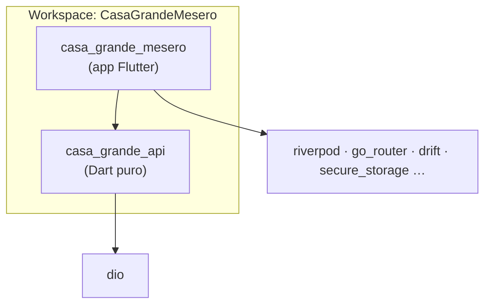
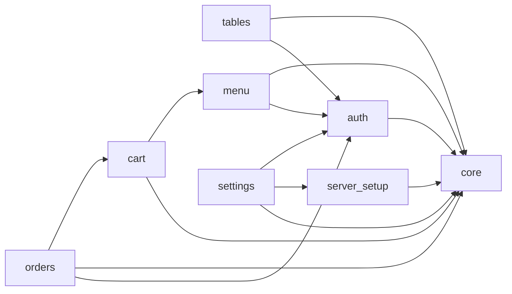

# 03 — Módulos y estructura

## 1. Paquetes (workspace de Dart)

Un repositorio, dos paquetes, **una sola resolución de dependencias** (`pubspec.lock` único). Los *workspaces* de Dart
exigen SDK ≥ 3.6 en todos los miembros; con Flutter 3.47 / Dart 3.13 se pueden usar las rutas con comodín.



| Paquete | Contenido | Por qué es un paquete aparte |
|---|---|---|
| `casa_grande_api` | `CasaGrandeApi`, interceptores, DTOs `freezed`+`json`, `ApiException`, validación de URL base | Es el contrato HTTP: se prueba sin Flutter ni emulador, y se puede probar **contra la API real** del escritorio (etiqueta `live`). Si mañana hay otra app (caja, cocina), lo reutiliza |
| `casa_grande_mesero` | Todo lo demás: UI, dominio, datos locales, módulos | La app |

No se parte más por ahora (un paquete por funcionalidad sería ceremonia para ~7 módulos y un solo equipo). El criterio para
extraer un módulo a paquete: lo usan dos apps o su compilación (`build_runner`) es lo que más tarda.

## 2. Módulos de la app (por funcionalidad)



| Módulo | Responsabilidad | Pantallas | Datos propios |
|---|---|---|---|
| **server_setup** | Configurar y probar el servidor (host, puerto, clave) | Emparejar | `ServerConfig` |
| **auth** | Sesión del mesero: elegir empleado, PIN/contraseña, vencimiento | Login | `Session`, `Employee` |
| **tables** | Mapa de mesas y su estado; sondeo | Mesas | `DiningTable` |
| **menu** | Catálogo (tipos, platos, bebidas, ingredientes), búsqueda, caché | Menú, Armar plato | `Dish`, `Beverage`, `Ingredient`, `ProductKind` |
| **cart** | Borrador de pedido por mesa: líneas, fusión, validación local, persistencia | Carrito / Revisar | `Draft`, `DraftLine` |
| **orders** | Enviar (`SubmitOrder`), bandeja de salida, detalle de pedido (y en MVP-2 editar) | Resultado, Detalle, Pendientes | `Order`, `OrderLine`, `OutboxEntry` |
| **settings** | Diagnóstico, cambiar servidor, cerrar sesión, preferencias, registros | Ajustes, Registros | `Preferences` |
| **core** | Transversal: tema, enrutado, l10n, errores, base de datos, almacenamiento seguro, `Pesos`, `Clock`, widgets comunes | — | — |

### 2.1 Reglas de dependencia entre módulos

1. Un módulo **no importa archivos internos de otro**: solo su fachada pública (`lib/features/<x>/<x>.dart`), que expone
   entidades, contratos y proveedores, **no** pantallas ni DTOs.
2. `core` no importa módulos.
3. Sin ciclos: el grafo de arriba es un DAG. `orders` depende de `cart` (lee el borrador para enviarlo) y `cart` de `menu`
   (necesita las entidades de producto); nunca al revés.
4. La navegación entre módulos va por **rutas con nombre**, no por importar la pantalla de otro módulo.
5. Se hace cumplir con una prueba de arquitectura (un test que recorre los `import` de `lib/features/*` y falla si se
   rompe una regla) además de los lints.

## 3. Árbol de carpetas

```text
CasaGrandeMesero/
├─ pubspec.yaml                  # workspace: [packages/*, app]
├─ analysis_options.yaml         # very_good_analysis + reglas propias
├─ .github/workflows/ci.yml
├─ docs/                         # enlaza al contrato de la API (repo del escritorio)
├─ packages/
│  └─ casa_grande_api/
│     ├─ lib/
│     │  ├─ casa_grande_api.dart            # fachada pública
│     │  └─ src/
│     │     ├─ client/        (api.dart, interceptors/, base_url.dart)
│     │     ├─ dto/           (login, table, dish, beverage, ingredient, order …)
│     │     └─ errors/        (api_exception.dart)
│     └─ test/                # + test/live/ (contra la API real, etiqueta live)
└─ app/
   ├─ pubspec.yaml
   ├─ l10n.yaml · lib/l10n/app_es.arb
   ├─ android/ · ios/
   ├─ lib/
   │  ├─ main.dart                # solo llama a bootstrap()
   │  ├─ bootstrap.dart           # zona de errores, Drift, almacenamiento, ProviderScope
   │  ├─ app.dart                 # MaterialApp.router, tema, localizaciones
   │  ├─ core/
   │  │  ├─ config/ (flavors, constantes)
   │  │  ├─ error/  (app_failure.dart, failure_mapper.dart)
   │  │  ├─ database/ (app_database.dart, tables/, daos/, converters/)
   │  │  ├─ storage/ (secure_store.dart, preferences.dart)
   │  │  ├─ routing/ (router.dart, route_names.dart, guards.dart)
   │  │  ├─ theme/ (app_theme.dart, colors.dart)
   │  │  ├─ time/ (clock.dart)       ├─ money/ (pesos.dart)
   │  │  ├─ logging/ (talker.dart)
   │  │  └─ widgets/ (empty_state, error_view, loading_skeleton, status_chip …)
   │  └─ features/
   │     ├─ server_setup/ ─ data/ domain/ presentation/ server_setup.dart
   │     ├─ auth/         ─ data/ domain/ presentation/ auth.dart
   │     ├─ tables/       ─ …
   │     ├─ menu/         ─ …
   │     ├─ cart/         ─ …
   │     ├─ orders/       ─ …
   │     └─ settings/     ─ …
   └─ test/                       # espejo de lib/, + architecture_test.dart y goldens
```

Dentro de cada módulo:

```text
features/orders/
├─ domain/
│  ├─ entities/        order.dart, order_line.dart, outbox_entry.dart      (freezed)
│  ├─ repositories/    orders_repository.dart, outbox_repository.dart      (abstract interface class)
│  └─ usecases/        submit_order.dart, sync_outbox.dart
├─ data/
│  ├─ repositories/    orders_repository_impl.dart, outbox_repository_impl.dart
│  ├─ mappers/         order_mapper.dart            (DTO ⇄ entidad)
│  └─ local/           outbox_dao.dart              (Drift)
├─ presentation/
│  ├─ providers/       order_detail_provider.dart, outbox_provider.dart    (@riverpod)
│  ├─ screens/         order_detail_screen.dart, outbox_screen.dart, submit_result_screen.dart
│  └─ widgets/         order_line_tile.dart, outbox_entry_card.dart
└─ orders.dart         # fachada: lo único que otros módulos pueden importar
```

## 4. Convenciones de código

| Tema | Regla |
|---|---|
| Nombres de archivos | `snake_case.dart`; una clase pública principal por archivo |
| Identificadores | Inglés; términos de dominio según el glosario de [04 §1](04-modelo-de-dominio-y-datos.md) |
| Cadenas visibles | Siempre desde `AppLocalizations` (ARB); nunca literales en widgets |
| Archivos generados | `*.g.dart`, `*.freezed.dart`, `*.drift.dart` **no se commitean**; CI y el *script* de arranque ejecutan `build_runner` |
| Tamaño | Widgets pequeños y `const` donde se pueda; pantalla > ~200 líneas se divide en widgets |
| Comentarios | En español, explican el **porqué** (no repiten el código) |
| Commits | En español, asunto y cuerpo; el cuerpo cuenta el porqué |
| Ramas | `feature/<módulo>-<tema>`; fusión a `main` con CI en verde |
