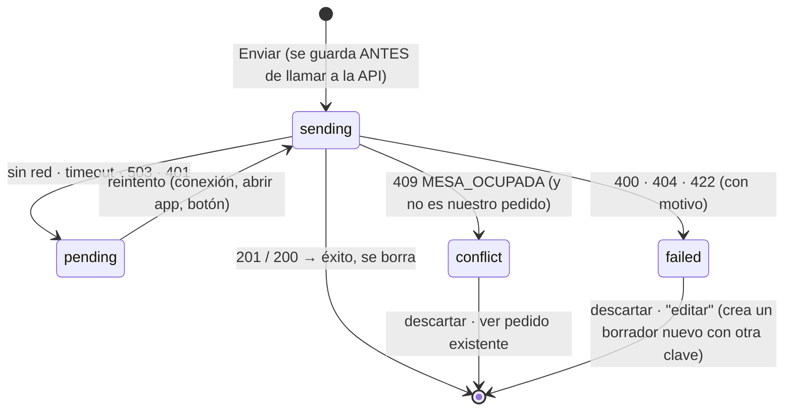

# 04 — Modelo de dominio y de datos

Los nombres de campos del JSON salen del [contrato v1](../04-contrato-api-v1.md) (implementado y probado). Aquí se fija
cómo se llaman y se tipan **dentro de la app**.

## 1. Glosario español → código

El JSON y la interfaz usan español; el código, inglés (regla del repositorio). Se evita `Table` (choca con el widget de Flutter)
y `Order` genérico de otras librerías: se prefijan cuando hay riesgo.

| Dominio (ES) | Código | Notas |
|---|---|---|
| Mesa | `DiningTable` | `Table` ya existe en Flutter |
| Plato / Bebida | `Dish` / `Beverage` | Ambos son un `Product` (ver 2.4) |
| Tipo de plato / de bebida | `DishType` / `BeverageType` | |
| Ingrediente | `Ingredient` | Tipo: `IngredientKind` = `soup`, `rice`, `side`, `drink` |
| Plato detallado | `Dish.isCustomizable` | `detallado == true`: exige 4 ingredientes |
| Plato de carta | `Dish.isALaCarte` | `carta`; informativo, no cambia reglas |
| Pedido | `Order`, líneas `OrderLine` | Lo que existe en el servidor |
| Borrador / carrito | `Draft`, líneas `DraftLine` | Lo que el mesero arma en el teléfono |
| Bandeja de salida | `OutboxEntry` | Pedido que se mandó a enviar y aún no se confirma |
| Empleado / mesero | `Employee` | |
| Turno | `Shift` | Solo lectura |
| Comensales | `diners` | `cantidad_clientes` |
| Observaciones | `notes` | |
| Pesos colombianos | `Pesos` | *extension type* sobre `int` |
| Precuenta (`SALIENDO`) | `OrderStatus.leaving` | Fase 4 |

## 2. Entidades de dominio

Todas inmutables (`freezed`), sin dependencias de Flutter ni de la red.

### 2.1 Conexión y sesión

| Entidad | Campos | Invariantes |
|---|---|---|
| `ServerConfig` | `host: String`, `port: int`, `apiKey: String` | `host` es IP privada, `localhost` o `*.local`; `port` 1–65535; `apiKey` no vacía. Deriva `baseUri` = `http://host:port/api/v1` |
| `Employee` | `id: int`, `name: String`, `role: String`, `hasPin: bool` | `id > 0` (el 0 es "NINGUNO") |
| `Shift` | `id: int`, `date: DateTime`, `status: String` | Solo informativa; puede faltar |
| `Session` | `employee: Employee`, `token: String`, `expiresAt: DateTime`, `shift: Shift?` | `isExpired(Clock)`; nunca contiene contraseña ni PIN |
| `ServerInfo` | `version: String`, `hostName: String`, `serverTime: DateTime`, `dbOk: bool` | Resultado de `/ping`; la app comprueba que la versión **mayor** sea `1` |

### 2.2 Mesas

| Entidad | Campos | Notas |
|---|---|---|
| `DiningTable` | `id: int`, `number: int`, `description: String`, `status: TableStatus`, `openOrderId: int?`, `openedAt: TimeOfDay?`, `diners: int`, `total: Pesos` | `openOrderId == null` ⇔ `status == free` |
| `TableStatus` | `free` (`DISPONIBLE`), `pending` (`PENDIENTE`), `leaving` (`SALIENDO`), `unknown` | `unknown` absorbe valores nuevos del servidor sin romper la app |

### 2.3 Menú

| Entidad | Campos |
|---|---|
| `DishType` | `id: int`, `name: String` |
| `BeverageType` | `id: int`, `name: String` |
| `Ingredient` | `id: int`, `kind: IngredientKind`, `name: String`, `description: String`, `isActive: bool` |
| `IngredientKind` | `soup` (`SOPA`), `rice` (`ARROZ`), `side` (`ACOMPANANTE`), `drink` (`BEBIDA`), `unknown` |
| `Dish` | `id`, `name`, `price: Pesos`, `typeId`, `typeName`, `description`, `isCustomizable: bool`, `isALaCarte: bool`, `imageUrl: Uri?` |
| `Beverage` | `id`, `name`, `price: Pesos`, `typeId`, `typeName`, `description`, `imageUrl: Uri?` |
| `Product` | `sealed`: `Dish` o `Beverage`; comparte `id`, `name`, `price`, `kind: ProductKind` (`dish`/`beverage`) |
| `Menu` | `dishTypes`, `beverageTypes`, `dishes`, `beverages`, `ingredients`, `fetchedAt: DateTime` (el snapshot que se cachea) |

Reglas del menú en el cliente: solo se muestran productos activos (la API ya filtra); `ingredientsOf(kind)` devuelve las
opciones de un tipo ordenadas con las "SIN …" **al final**; una opción es "SIN …" si el nombre empieza por `SIN` (convención
actual de los datos; si cambia, el servidor sigue aceptando cualquier ingrediente activo).

### 2.4 Borrador (carrito)

| Entidad | Campos | Invariantes (validación local) |
|---|---|---|
| `DraftLine` | `lineId: String` (UUID local), `productKind`, `productId`, `nameSnapshot`, `priceSnapshot: Pesos`, `quantity: int`, `notes: String`, `ingredients: Map<IngredientKind, IngredientChoice>` | `quantity` 1–999; `notes` ≤ 100; si el producto es plato personalizable: **los 4 tipos presentes**; si no: mapa vacío |
| `IngredientChoice` | `ingredientId: int`, `nameSnapshot: String` | |
| `Draft` | `id: String` (**UUID v4 = clave de idempotencia**), `tableId`, `tableNumber`, `employeeId`, `lines: List<DraftLine>`, `notes: String`, `diners: int`, `createdAt`, `updatedAt` | ≥ 1 línea para enviar; ≤ 200 líneas; `notes` ≤ 200; `diners` 0–1000 |

Operaciones (puras, probables sin UI): `addLine`, `increment/decrement`, `remove`, `setNotes`, `merge`, `estimatedTotal`.

**Fusión de líneas:** al agregar una línea, si ya hay otra con el mismo `(productKind, productId, notes, ingredients)` se
suma la cantidad; si cualquier cosa difiere, es una línea nueva (así dos almuerzos con sopas distintas son dos filas, como
en el escritorio).

**Total estimado:** `Σ priceSnapshot × quantity`. Es solo para el usuario; el total real lo devuelve el servidor.

**Revalidación antes de enviar:** se compara cada línea con el menú en caché: producto que ya no está → aviso y no se puede
enviar hasta quitarlo; precio distinto → se actualiza el *snapshot* y se avisa ("el precio de X cambió a $ …").

### 2.5 Pedido (lo que existe en el servidor)

| Entidad | Campos |
|---|---|
| `Order` | `id`, `tableId`, `tableNumber`, `customerId`, `customerName`, `employeeId`, `employeeName`, `status: OrderStatus`, `date: DateTime`, `time: TimeOfDay`, `notes`, `diners`, `total: Pesos`, `lines: List<OrderLine>` |
| `OrderLine` | `id` (= `id_detalle_pedido`), `productKind`, `productId`, `name`, `unitPrice: Pesos`, `quantity`, `lineTotal: Pesos`, `notes`, `ingredients: List<OrderIngredient>` |
| `OrderIngredient` | `ingredientId`, `kind: IngredientKind`, `name` |
| `OrderStatus` | `pending` (`PENDIENTE`), `leaving` (`SALIENDO`), `available` (`DISPONIBLE`, ya facturado), `cancelled` (`CANCELADO`), `unknown` |
| `SubmitResult` | `order: Order`, `wasReplay: bool` (`200` en vez de `201`), `printQueued: bool` |

`Order.total` y `OrderLine.lineTotal` se **toman del servidor**, no se recalculan. Las filas se agrupan solo para mostrar
(una misma opción repetida), conservando los `id` para poder quitarlas (MVP-2).

### 2.6 Bandeja de salida

| Entidad | Campos |
|---|---|
| `OutboxEntry` | `id: int`, `idempotencyKey: String`, `tableId`, `tableNumber`, `employeeId`, `payload: String` (el JSON exacto de `POST /pedidos`), `summary: OutboxSummary` (líneas y total estimado, para listar sin reanalizar), `status: OutboxStatus`, `attempts: int`, `lastAttemptAt: DateTime?`, `lastError: OutboxError?`, `serverOrderId: int?`, `createdAt` |
| `OutboxStatus` | `sending`, `pending`, `conflict`, `failed` (un envío exitoso **borra** la entrada) |
| `OutboxError` | `code: String`, `message: String` |



Reglas:

* **Una entrada por mesa** (`UNIQUE(table_id)`): mientras haya una sin resolver, esa mesa no admite un borrador nuevo
  (el mapa la marca "pendiente de envío").
* **El `payload` es inmutable**: un reintento manda exactamente los mismos bytes (el servidor compara el *hash* del
  cuerpo; otro cuerpo con la misma clave sería `409 CONFLICTO`). "Editar" un envío fallido crea un borrador nuevo con
  clave nueva y borra la entrada vieja.
* **¿`MESA_OCUPADA` es nuestro propio pedido?** Pasa si el servidor sí creó el pedido, se perdió la respuesta y el `.exe`
  se reinició (olvidó la clave). Antes de declarar conflicto, la app consulta `GET /mesas` → `openOrderId` →
  `GET /pedidos/{id}` y lo da por **suyo** si coinciden: mismo empleado, hora de creación ≥ `createdAt` de la entrada y la
  misma "huella" (mismas filas: producto + cantidad + ingredientes). Si es suyo → éxito y se limpia; si no → `conflict`.

## 3. Correspondencia con la API (DTO ⇄ entidad)

Los DTOs viven en `casa_grande_api` (con `@JsonKey(name: …)` para el snake_case español); los mapeadores en cada `data/mappers/`.

| Endpoint | DTO | → Entidad | Conversiones |
|---|---|---|---|
| `GET /ping` | `PingDto{ok,version,servidor,hora,db}` | `ServerInfo` | `hora` ISO local → `DateTime` |
| `POST /auth/login` | `LoginRequestDto{id_empleado, password? \| codigo_maestra?}` · `LoginResponseDto{token,expira,empleado{…},turno?}` | `Session` | `expira` ISO local; exactamente **una** credencial |
| `GET /mesas` | `TableDto{id_mesa,num_mesa,descripcion,estado,id_pedido,hora,cantidad_clientes,total}` | `DiningTable` | `estado`→`TableStatus` (desconocido→`unknown`); `id_pedido==0`→`null`; `hora` `"HH:mm"`\|`null` |
| `GET /tipos-platos` · `/tipos-bebidas` | `{id_tipo_plato,tipo_plato}` · `{id_tipo_bebida,tipo_bebida}` | `DishType`/`BeverageType` | |
| `GET /platos` | `DishDto{id_plato,nombre,precio,id_tipo_plato,tipo_plato,descripcion,detallado,carta,imagen_url}` | `Dish` | `precio` (int) → `Pesos`; `imagen_url` `null`→sin imagen |
| `GET /bebidas` | `BeverageDto{id_bebida,nombre,precio,id_tipo_bebida,tipo_bebida,descripcion,imagen_url}` | `Beverage` | |
| `GET /ingredientes` | `IngredientDto{id_ingrediente,tipo,nombre,descripcion,estado}` | `Ingredient` | `tipo`→`IngredientKind`; `estado=="ACTIVO"`→`isActive` |
| `POST /pedidos` | `CreateOrderDto{idempotencia,id_mesa,id_cliente,cantidad_clientes,tipo_pedido,observaciones,imprimir_comandas,copias_comandas,items[{tipo,id_tipo,cantidad,observaciones,ingredientes[{id_ingrediente}]}]}` | construido desde `Draft` | `tipo_pedido` = `"MESA"` siempre; `id_cliente` = 0; **no se envía `precio`** |
| `POST /pedidos` · `GET /pedidos/{id}` | `OrderDto{id_pedido,id_mesa,num_mesa,id_cliente,cliente,id_empleado,empleado,estado,fecha,hora,tipo_pedido,observaciones,cantidad_clientes,total,items[…],impreso?}` | `Order`, `SubmitResult` | `items[].id_detalle_pedido`→`OrderLine.id`; `impreso`→`printQueued` |
| Error | `{error:{codigo,mensaje,detalle}}` | `AppFailure` (ver 5) | |

**Resistencia a cambios del servidor:** los DTOs ignoran campos desconocidos y toleran enums desconocidos (→ `unknown`);
un campo obligatorio ausente es `UnexpectedFailure` con el nombre del campo en el registro, no un crash.

**Construcción del cuerpo de `POST /pedidos`** (caso de uso `BuildOrderPayload`): una entrada de `items` **por `DraftLine`**,
en el orden del borrador; `ingredientes` = los 4 ids del mapa (solo platos personalizables); `observaciones` recortadas;
`idempotencia` = `Draft.id`; `imprimir_comandas` = siempre `true`; `copias_comandas` = lo que elige el mesero en la confirmación (2 por defecto, de 1 a 5).

## 4. Esquema local (SQLite con Drift)

```sql
-- Un borrador por mesa. draft_id es la clave de idempotencia y no cambia en la vida del borrador.
CREATE TABLE drafts (
  table_id      INTEGER PRIMARY KEY,                -- id_mesa
  draft_id      TEXT    NOT NULL UNIQUE,            -- UUID v4
  table_number  INTEGER NOT NULL,
  employee_id   INTEGER NOT NULL,
  notes         TEXT    NOT NULL DEFAULT '',
  diners        INTEGER NOT NULL DEFAULT 0,
  lines_json    TEXT    NOT NULL,                   -- List<DraftLine> (convertidor de tipo)
  created_at    INTEGER NOT NULL,
  updated_at    INTEGER NOT NULL
);

-- Pedidos mandados a enviar y aún sin confirmar. Un envío exitoso borra la fila.
CREATE TABLE outbox (
  id               INTEGER PRIMARY KEY AUTOINCREMENT,
  idempotency_key  TEXT    NOT NULL UNIQUE,
  table_id         INTEGER NOT NULL UNIQUE,          -- una entrada sin resolver por mesa
  table_number     INTEGER NOT NULL,
  employee_id      INTEGER NOT NULL,
  payload_json     TEXT    NOT NULL,                 -- cuerpo EXACTO de POST /pedidos (inmutable)
  summary_json     TEXT    NOT NULL,                 -- líneas y total estimado, para listar
  status           TEXT    NOT NULL CHECK (status IN ('sending','pending','conflict','failed')),
  attempts         INTEGER NOT NULL DEFAULT 0,
  last_attempt_at  INTEGER,
  last_error_code  TEXT,
  last_error_msg   TEXT,
  server_order_id  INTEGER,
  created_at       INTEGER NOT NULL
);
CREATE INDEX ix_outbox_status_created ON outbox (status, created_at);

-- Menú en caché: un documento JSON por clave (dish_types, beverage_types, dishes, beverages, ingredients).
CREATE TABLE cache_entries (
  key             TEXT    PRIMARY KEY,
  json            TEXT    NOT NULL,
  fetched_at      INTEGER NOT NULL,
  schema_version  INTEGER NOT NULL                   -- si cambia el formato, la entrada se descarta
);
```

Por qué así:

* **JSON dentro de columnas** para las líneas del borrador y el catálogo: se leen y escriben enteros (atómicos), no se
  consultan por dentro y evitan migraciones cada vez que el servidor añade un campo. Lo que sí se consulta o ordena
  (`status`, `created_at`, `table_id`) está en columnas con índice.
* Con ~600 productos el filtrado por texto se hace en memoria (microsegundos); no hace falta FTS.
* **Migraciones desde el día 1:** `schemaVersion = 1`, `MigrationStrategy` explícita y *pruebas de migración* generadas con
  las herramientas de Drift; ningún cambio de esquema sin migración y sin prueba.
* Una **transacción** envuelve cada cambio compuesto (p. ej. mover del borrador a la bandeja de salida).

## 5. Almacenamiento seguro y preferencias

| Clave | Almacén | Contenido |
|---|---|---|
| `server.apiKey` | `flutter_secure_storage` | Clave `X-Api-Key` |
| `session.token` · `session.expiresAt` | `flutter_secure_storage` | Token de 8 h y su vencimiento |
| `server.host` · `server.port` | `shared_preferences` | Dirección del servidor (no es secreto) |
| `session.employee` | `shared_preferences` | `Employee` en JSON (id, nombre, cargo) para pintar la UI al arrancar |
| `ui.themeMode` · `ui.tablesPollSeconds` | `shared_preferences` | Preferencias |
| `ui.lastEmployeeId` | `shared_preferences` | Para preseleccionar en el Login |

Al **cerrar sesión**: se borran token y vencimiento; los borradores y la bandeja **se conservan** (son del dispositivo y de la
mesa, no de la sesión). Al **cambiar de servidor**: se pide confirmación y se borra todo lo local (el menú y las mesas
son de otro restaurante/servidor).

## 6. Fallos de dominio (`AppFailure`)

| Origen | Fallo | Mensaje para el usuario (clave ARB) | Qué hace la app |
|---|---|---|---|
| Timeout / sin ruta / conexión rechazada | `NetworkFailure` | "No se pudo conectar con el servidor" | Banner "Sin conexión"; el pedido va a la bandeja |
| `401` | `UnauthorizedFailure` | "Tu sesión venció" | Ir a Login conservando borradores |
| `403 CLAVE_INVALIDA` | `BusinessFailure(invalidCredentials)` | "Usuario o clave incorrectos" | Mensaje en el Login |
| `403 IP_NO_PERMITIDA` | `BusinessFailure` | "El servidor no acepta este dispositivo (red)" | Ayuda de diagnóstico |
| `429 DEMASIADOS_INTENTOS` | `BusinessFailure(tooManyAttempts)` | "Demasiados intentos. Espera N s" | Cuenta regresiva en el Login |
| `409 MESA_OCUPADA` | `BusinessFailure(tableBusy)` | mensaje del servidor | Ver 2.6 (¿es nuestro?) |
| `404/422 REGLA_NEGOCIO/NO_ENCONTRADO` | `BusinessFailure` | mensaje del servidor | Entrada `failed`; el mesero corrige |
| `400 VALIDACION` | `BusinessFailure(validation)` | mensaje del servidor | No debería ocurrir (la UI valida antes): se registra como error de programación |
| `409 CONFLICTO` | `BusinessFailure(conflict)` | "Esa clave ya se usó con otro pedido" | Solo por bug: nunca se reutiliza una clave con otro cuerpo |
| `5xx` / `503 BD_NO_DISPONIBLE` | `ServerFailure` | "El servidor tiene un problema" | Reintentable |
