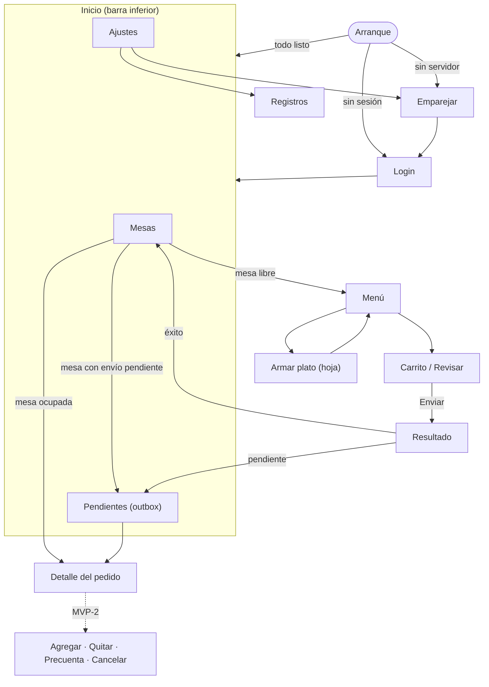

# 05 — Pantallas y flujos

## 1. Mapa de navegación



Rutas (ver [02 §4](02-arquitectura.md)): `/setup`, `/login`, `/tables`, `/tables/:tableId/menu`, `/tables/:tableId/cart`,
`/orders/:orderId`, `/outbox`, `/settings`, `/settings/logs`.

## 2. Inventario de pantallas

Estados que **toda** pantalla con datos cubre: *cargando* (esqueletos, no ruedas giratorias a pantalla completa), *vacío*,
*error* (mensaje + «Reintentar»), *sin conexión* (con lo que haya en caché) y *datos*.

| # | Pantalla | Módulo | Propósito | Datos | Acciones principales |
|---|---|---|---|---|---|
| P1 | **Emparejar** | server_setup | Indicar dónde está el servidor y probarlo | `ServerConfig`, `ServerInfo` | Probar conexión · Guardar · (QR después) |
| P2 | **Login** | auth | Identificarse | Empleados activos (B1) | Elegir empleado · PIN/contraseña · Entrar |
| P3 | **Mesas** | tables | Ver el estado de las 36 mesas | `DiningTable[]` (sondeo) | Tocar mesa · Tirar para actualizar |
| P4 | **Menú** | menu | Elegir productos para una mesa | `Menu` (caché) + borrador | Buscar · Filtrar por tipo · Agregar · Ir al carrito |
| P5 | **Armar plato** (hoja inferior) | menu | Elegir los 4 ingredientes de un plato detallado | `Ingredient[]` | Elegir sopa/arroz/acompañante/bebida · Cantidad · Nota · Agregar |
| P6 | **Carrito / Revisar** | cart | Revisar y enviar | `Draft` | Cambiar cantidad · Quitar · Nota general · Comensales · Enviar |
| P7 | **Resultado del envío** | orders | Confirmar o explicar | `SubmitResult` / `OutboxEntry` | Ver pedido · Volver a mesas · Reintentar · Descartar |
| P8 | **Detalle del pedido** | orders | Ver lo pedido y su total | `Order` | (MVP-2) Agregar · Quitar · Precuenta · Cancelar · Reimprimir |
| P9 | **Pendientes de envío** | orders | Ver y resolver la bandeja | `OutboxEntry[]` | Reintentar · Ver · Editar (borrador nuevo) · Descartar |
| P10 | **Ajustes** | settings | Diagnóstico y preferencias | `ServerInfo`, `Session`, versión | Cambiar servidor · Cerrar sesión · Imprimir por defecto · Tema · Actualizar menú |
| P11 | **Registros** | settings | Ver el registro local para soporte | Talker | Filtrar · Copiar |

## 3. Maquetas de las pantallas críticas

*(esquemas de disposición, no diseño final)*

### P3 — Mesas

```text
┌──────────────────────────────┐
│ Casa Grande · Mesas   ● En línea │   ← punto: verde en línea / ámbar reintentando / rojo sin conexión
│ Hola, Camila               🔄  │
├──────────────────────────────┤
│ ┌────┐ ┌────┐ ┌────┐ ┌────┐   │
│ │ 1  │ │ 2  │ │ 3  │ │ 4  │   │   Cada tarjeta: número grande,
│ │ ✔  │ │ ⏳ │ │ ✔  │ │ ⏳ │   │   ícono + texto de estado (no solo color),
│ │Libre│ │$134k│ │Libre│ │$ 10k│  │   total y hora si está ocupada.
│ └────┘ └────┘ └────┘ └────┘   │
│ ┌────┐ ┌────┐ ┌────┐ ┌────┐   │   Leyenda: Libre (verde) · Pendiente (ámbar)
│ │ 5  │ │ 6  │ │ 7  │ │ 8  │   │   · Saliendo (naranja) · Envío pendiente (azul, ↑)
│ └────┘ └────┘ └────┘ └────┘   │
├──────────────────────────────┤
│  Mesas      Pendientes (2)  Ajustes │
└──────────────────────────────┘
```

* Rejilla adaptativa (columnas según el ancho; en tablet, más columnas).
* Tocar mesa **libre** → Menú (crea el borrador al agregar el primer producto, no al entrar).
* Tocar mesa **ocupada** → Detalle del pedido. Mesa con **envío pendiente** → esa entrada de la bandeja.
* Las mesas "con borrador sin enviar" (en este teléfono) llevan un punto, para retomarlas.

### P4 — Menú

```text
┌──────────────────────────────┐
│ ← Mesa 5                  🛒 3 │   ← carrito con contador; abre P6
│ [ 🔍 Buscar plato o bebida ] │
│ [Platos] [Bebidas]           │   ← pestañas
│ (Todos)(Almuerzos)(Hamburg.)(Picadas)… │   ← chips de tipo, desplazables
├──────────────────────────────┤
│ Almuerzo ejecutivo   $ 15.500 │
│ Con sopa, arroz y bebida   [+] │
│──────────────────────────────│
│ Hamburguesa sencilla  $ 12.000 │
│ …                          [+] │
├──────────────────────────────┤
│ Total estimado  $ 61.500  [Ver pedido] │   ← barra inferior fija
└──────────────────────────────┘
```

* Tarjetas sin imagen (hoy no hay); si `imagen_url != null`, miniatura con carga diferida y *placeholder*.
* `[+]` en un producto **simple** suma 1 (con vibración suave). En un plato **personalizable** abre P5.
* Búsqueda con *debounce* (250 ms), filtrado en memoria sobre el menú en caché; sin acentos ni mayúsculas.
* Banner discreto "Menú de hace 12 min · sin conexión" cuando aplica.

### P5 — Armar plato (hoja inferior modal)

```text
┌──────────────────────────────┐
│ Almuerzo ejecutivo   $ 15.500 │
│ Sopa *          (•) Sopa  ( ) Crema  ( ) Sin sopa │
│ Arroz *         (•) Blanco ( ) Coco  ( ) Sin arroz │
│ Acompañante *   ( ) Frijol ( ) Papa … ( ) Sin acompañante │
│ Bebida *        ( ) Jugo del día ( ) Mazamorra ( ) Sin bebida │
│ Nota (opcional)  [ sin cebolla            ] │
│ Cantidad         [ – ]  1  [ + ]            │
│ [ Agregar al pedido · $ 15.500 ]            │   ← deshabilitado hasta tener los 4
└──────────────────────────────┘
```

* Los cuatro grupos son **obligatorios** (un asterisco y el botón no se habilita hasta completarlos), como exige el servidor
  (`422` si falta uno). "Sin …" es una opción válida y está al final de cada grupo.
* Recuerda la **última elección** por tipo dentro de la sesión para agilizar platos repetidos (los meseros suelen pedir
  varios iguales); editable.

### P6 — Carrito / Revisar

```text
┌──────────────────────────────┐
│ ← Mesa 5 · Revisar pedido     │
│ 2 × Almuerzo ejecutivo  $ 31.000 │
│    Sopa · Blanco · Papa · Jugo del día │
│    "sin cebolla"          [–][+][🗑] │
│ 1 × Almuerzo ejecutivo  $ 15.500 │
│    Crema · Coco · Frijol · Sin bebida  │
│ 3 × Gaseosa 400 ml      $ 12.000 │
│ Comensales [ – ] 2 [ + ]   Nota general [ ... ] │
│ ☐ Imprimir comanda en cocina                │   ← por defecto = preferencia
├──────────────────────────────┤
│ Total estimado          $ 58.500 │
│ [ Enviar a cocina ]              │
└──────────────────────────────┘
```

* "Total estimado": el definitivo lo calcula el servidor (se muestra en P7).
* El botón queda deshabilitado mientras se envía (evita doble toque; aun así la idempotencia protege).
* Guardado automático del borrador en cada cambio: salir de la pantalla o cerrar la app no pierde nada.

## 4. Flujos clave

### F1 — Primer uso

1. Instalar → **Emparejar**: IP del PC del restaurante, puerto (8099 por defecto) y clave de la API → «Probar».
   `GET /ping`: debe responder `ok`, `db: true` y versión mayor `1`. Se muestra el **nombre del servidor** para que el
   usuario confirme que es el correcto.
2. **Login**: elegir empleado de la lista y teclear PIN o contraseña.
3. **Mesas**. El menú se descarga y se guarda en segundo plano.

### F2 — Tomar un pedido (camino feliz)

Mesas → mesa libre → Menú → agregar productos (los platos detallados pasan por P5) → Carrito → Enviar → Resultado "Pedido #N
enviado · $ 58.500" → vuelve a Mesas (la mesa ya aparece ocupada).

### F3 — Se cae el WiFi al enviar

Enviar → sin respuesta (3 s para conectar, 10 s en total) → la entrada queda `pending` → Resultado "**Guardado, se enviará
cuando haya conexión**" con la mesa marcada en azul. Al volver la conexión, el sincronizador la envía; si el servidor sí
había creado el pedido, la clave de idempotencia lo devuelve sin duplicar. Una notificación local discreta no es necesaria:
el contador de **Pendientes** en la barra inferior y la mesa lo muestran.

### F4 — La sesión vence con el borrador a medias

Cualquier llamada con `401` → pantalla Login encima ("Tu sesión venció, vuelve a entrar"), con el empleado preseleccionado.
Tras entrar, **vuelve exactamente donde estaba** (la ruta original se conserva) con el borrador intacto.

### F5 — Otro mesero ya abrió la mesa

Enviar → `409 MESA_OCUPADA` ("La mesa 5 ya tiene un pedido pendiente (#123)") → la app comprueba si el #123 es **su propio**
envío (ver [04 §2.6](04-modelo-de-dominio-y-datos.md)). Si no: Resultado de conflicto con «Ver pedido #123», «Elegir otra mesa»
(reasigna el borrador sin perder líneas, con **clave nueva**) o «Descartar».

### F6 — Consultar una mesa ocupada

Mesas → mesa ocupada → Detalle (`GET /pedidos/{id}`): filas agrupadas por producto con sus ingredientes, observaciones, hora,
mesero y total real.

### F7 — MVP-2: agregar y quitar (fase 4 de la API)

* **Agregar:** desde el Detalle → Menú en modo "agregar a pedido #N" → Enviar → `POST /pedidos/{id}/items` (filas nuevas).
* **Quitar:** deslizar una fila → pide **clave maestra** (PIN) → `DELETE /pedidos/{id}/items/{id_detalle_pedido}` (se
  direcciona por el id real de la fila).
* **Precuenta:** botón → `PATCH …/estado` (`SALIENDO`); la mesa pasa a naranja.
* **Cancelar:** pide motivo (obligatorio) y PIN → `POST …/cancelar`.
* Toda operación de edición es **en línea** (no pasa por la bandeja de salida): modificar un pedido sin saber el estado actual
  del servidor es más peligroso que pedirle al mesero que espere a tener conexión.

## 5. Microinteracciones y UX

* **Háptica** suave al agregar/quitar; **SnackBar** con «Deshacer» al quitar una línea.
* Diálogos de confirmación solo para lo destructivo (descartar un envío, cancelar un pedido, cambiar de servidor).
* Los teclados numéricos para PIN, cantidades y comensales; el PIN se oculta y no sugiere ni autocompleta.
* Estado de conexión siempre visible (punto en la barra superior), no solo cuando algo falla.
* Textos cortos, imperativos y sin jerga ("Enviar a cocina", no "Submit order").
* Respetar escala de texto grande: las tarjetas de mesa se reacomodan en vez de truncarse.
